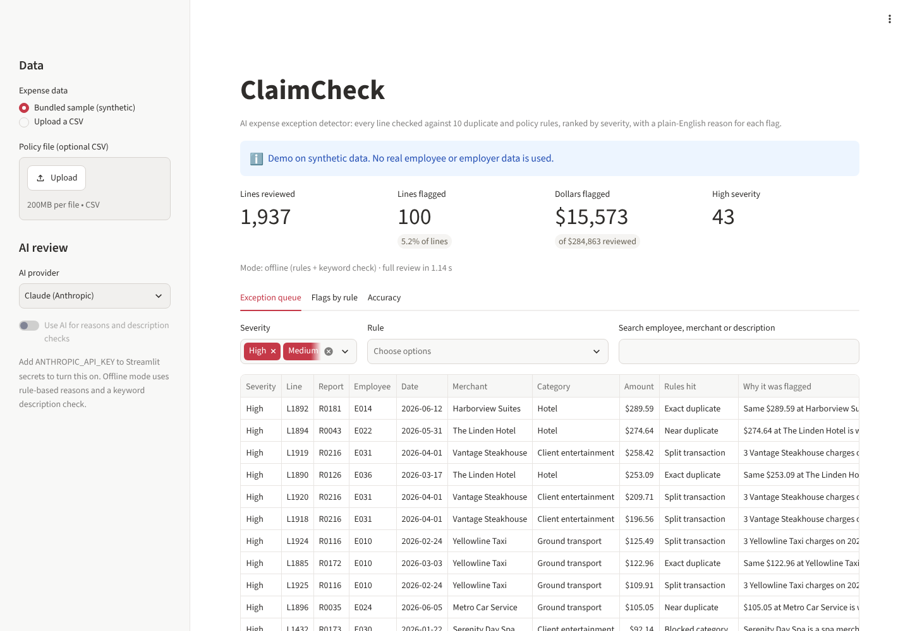
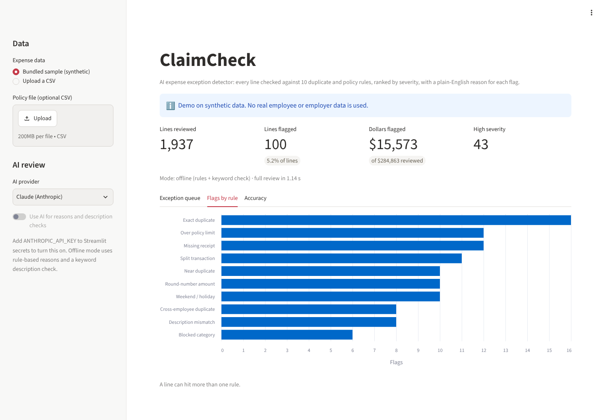
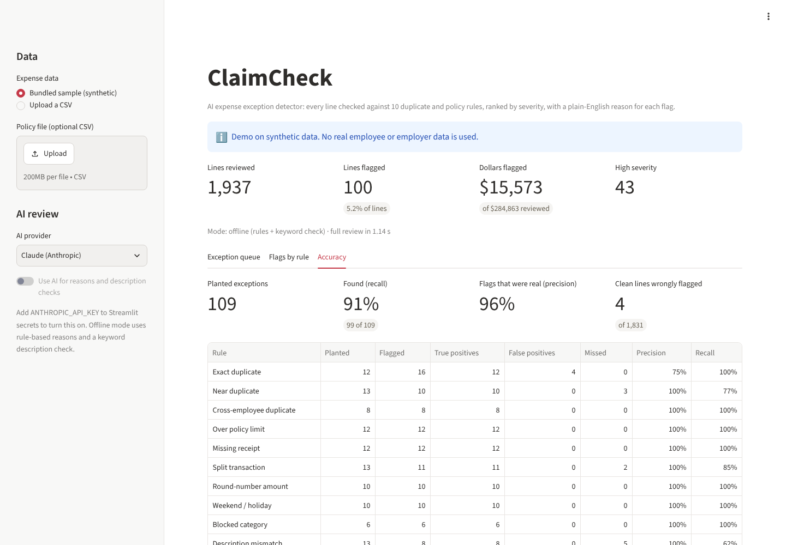

# ClaimCheck: AI Expense Exception Detector

ClaimCheck reviews every line of an expense export instead of a sample. It checks each line against 10 duplicate and policy rules, ranks the exceptions by severity, and uses an AI model (Claude or Grok) to write a plain-English reason for each flag, so a reviewer can act without re-reading the report.

> Demo on synthetic data. No real employee or employer data is used.

**Live demo (Python app):** https://claimcheck-dowden.streamlit.app (offline mode, no API key)

**API (Python engine as a web service):** https://claimcheck-api.vercel.app, the backend the front end calls; see [service/README.md](service/README.md).

**Front-end prototype (live):** https://claimcheck-truth-compass.lovable.app, the reviewer experience built in Lovable (`frontend/`), using the same 10 rules in the browser on its own synthetic dataset.



| Flags by rule | Accuracy against the planted answer key |
| --- | --- |
|  |  |

Screenshots: the Streamlit app in offline mode on the bundled synthetic data.

## Results on the synthetic test set

1,937 synthetic lines, 109 planted exceptions. Offline uses the rules plus a keyword description check; AI mode adds Claude (`claude-haiku-5-5`) for rule 10 and the reasons.

| | Found (recall) | Flags that were real (precision) | Description mismatches found | Clean lines wrongly flagged |
| --- | ---: | ---: | ---: | ---: |
| Offline | 99 of 109 (91%) | 96% | 8 of 13 | 4 of 1,831 |
| AI mode | 104 of 109 (95%) | 93% | 13 of 13 | 5 of 1,831 |

### Offline, by rule

| Rule | Planted | Found | False positives | Missed |
| --- | ---: | ---: | ---: | ---: |
| Exact duplicate | 12 | 12 | 4 | 0 |
| Near duplicate | 13 | 10 | 0 | 3 |
| Cross-employee duplicate | 8 | 8 | 0 | 0 |
| Over policy limit | 12 | 12 | 0 | 0 |
| Missing receipt | 12 | 12 | 0 | 0 |
| Split transaction | 13 | 11 | 0 | 2 |
| Round-number amount | 10 | 10 | 0 | 0 |
| Weekend / holiday | 10 | 10 | 0 | 0 |
| Blocked category | 6 | 6 | 0 | 0 |
| Description mismatch | 13 | 8 | 0 | 5 |
| **All rules** | **109** | **99 (91% recall)** | **4 (96% precision)** | **10** |

- 4 of 1,831 clean lines wrongly flagged; full review in about 1 second.
- The misses and false positives are designed into the test set:
  - **3 near duplicates** are 3-5% apart, outside the 2% tolerance.
  - **2 split lines** are spread across two days; the rule checks one day at a time.
  - **5 description mismatches** are personal spend written in business words ("Family dinner while on vacation"). The keyword check can't see these; the Claude AI step is built to catch them.
  - **4 false positives** are same-fare round-trip car rides on one day (legitimate, but identical to a duplicate). A reviewer clears these in seconds.

### AI mode

Run on 2026-11-14 on Windows with `claude-haiku-5-5`, on the dataset as of commit 8d6f0da. It took about 2.5 minutes; responses are cached, so re-runs are free.

- **Description mismatch:** 13 of 13 found (offline: 8), including all 5 personal-spend descriptions written in business words. All other rules are deterministic and scored the same as offline.
- **8 rule-level false positives:** the same 4 round-trip car rides, plus 4 description flags that weren't in the answer key:
  - 3 lines already planted as blocked merchants, where the description doesn't fit the merchant ("Team lunch" at a liquor store, "Lunch with client" at a spa). These are real inconsistencies; the answer key only labeled the blocked merchant.
  - 1 test-data defect: line L0150 was charged at DataNest but described as a SlideCraft license. The generator re-drew the merchant without updating the description. Fixed after this run, along with a second line (L1266) that had the same defect; offline results are unchanged, and a test now checks for it.
- **5 missed:** the deliberate near-duplicate and two-day split cases, which no rule is tuned to catch.

AI-mode numbers are from that single run, not reproduced in CI (CI never calls a paid model).

## How it works

```
Expense CSV + policy CSV
  -> rules engine (Python, pandas)      rules 1-9, deterministic and repeatable
  -> AI review (Claude or Grok API)     rule 10 + a one-sentence reason per flag
  -> exception queue (Streamlit)        sorted by severity, then amount
  -> CSV export + accuracy report
```

| # | Rule | Flags | Severity |
| --- | --- | --- | --- |
| 1 | Exact duplicate | Same employee, merchant, date and amount (later line flagged) | High |
| 2 | Near duplicate | Same employee and merchant, amount within 2%, dates within 3 days | High |
| 3 | Cross-employee duplicate | Same merchant, date and amount claimed by two employees (meals, client entertainment, ground transport only; group hotel rates are normal) | Medium |
| 4 | Over policy limit | Amount above the category limit | Medium |
| 5 | Missing receipt | Over the receipt threshold with no receipt | Medium |
| 6 | Split transaction | 2+ lines, same employee/merchant/day, each under the limit, together over it | High |
| 7 | Round-number amount | Whole-dollar amount at or above $100 | Low |
| 8 | Weekend / holiday | Software, office supplies or client entertainment on a weekend or holiday | Low |
| 9 | Blocked category | Casino, liquor store, gift card or spa merchants | High |
| 10 | Description mismatch | Description doesn't fit a business expense in that category (AI; keyword check offline) | Medium |

All limits and lists live in `data/policy.csv` and can be edited in Excel. The policy loader rejects unknown settings, duplicate entries, negative or non-numeric amounts and invalid holiday dates.

## Run it locally

```bash
python -m venv .venv && source .venv/bin/activate      # Windows: see below
pip install --require-hashes -r requirements.lock      # Python 3.11, exact pinned versions
# (or: pip install -r requirements.txt on other Python versions)

python -m src.generate_data        # builds data/expenses.csv and data/policy.csv (fixed seed)
python -m src.pipeline --no-ai     # offline run: exception queue + accuracy report in output/
python -m pytest -q                # 45 tests, no network calls
python scripts/scan_secrets.py     # credential scan of tracked files
streamlit run app.py               # the web app
```

### Windows (PowerShell)

```powershell
py -3.11 -m venv .venv
.venv\Scripts\activate
pip install --require-hashes -r requirements.lock      # or: pip install -r requirements.txt
python -m pytest -q
python -m src.pipeline --no-ai
streamlit run app.py
```

In a folder that isn't a Git checkout (a ZIP download or copied folder), the tracked-file secret-scan test is skipped (44 passed, 1 skipped); CI always runs it.

### Turn on the AI step (paid inference: approve before running)

Two providers are supported. Set the key in your terminal session only, never in a file inside the repo.

```bash
export AI_PROVIDER=anthropic              # or: xai
export ANTHROPIC_API_KEY=sk-ant-...       # or: export XAI_API_KEY=xai-...
python -m src.pipeline                     # AI mode
unset ANTHROPIC_API_KEY                    # clear it when done
```

On Windows PowerShell, copy the key from your password manager and load it from the clipboard, so it never appears on screen or in your command history:

```powershell
$env:ANTHROPIC_API_KEY = (Get-Clipboard).Trim()
Set-Clipboard -Value " "                                   # clear the clipboard
if ($env:ANTHROPIC_API_KEY -like "sk-ant-*") { "key is set" } else { "key NOT set" }
python -m src.pipeline
```

If you type it instead, keep the quotes: `$env:ANTHROPIC_API_KEY="..."`. Never paste a key into a chat, issue or file. If one is exposed, delete it in the console and create a new one.

If `AI_PROVIDER` is unset, the first provider with a key is used (Anthropic, then xAI). Default models: `claude-haiku-5-5` and `grok-4.5`; override with `CLAIMCHECK_MODEL` (check docs.x.ai for current Grok model names). In the app, pick the provider in the sidebar; keys come from Streamlit secrets. Responses are cached in `output/ai_cache.json`, so re-runs are free. Use a dedicated key with a low monthly spend limit.

## Deploy a public demo (free)

1. Push this folder to a public GitHub repo (the `.gitignore` keeps your key out).
2. Go to share.streamlit.io, choose **New app**, pick the repo and set the main file to `app.py`.
3. Under **Advanced settings > Secrets**, paste `AI_PROVIDER` and the matching key (see `.streamlit/secrets.toml.example`). Leave them out to run the demo in offline mode at no cost.
4. Set a monthly spend limit on your Anthropic key before sharing the link.

## Governance and CI

Changes reach `main` only through reviewed pull requests; there is no auto-merge. See `docs/AUTO_001_CONTROLS.md` and `PHASE_0_CONTROLS.md`.

GitHub Actions (`.github/workflows/ci.yml`) runs on every pull request and push to `main`, offline, with both provider keys blanked:

- installs `requirements.lock` with `--require-hashes` on Python 3.11
- runs the full test suite
- scans tracked files for credential-shaped text (`scripts/scan_secrets.py`)
- fails if a secret-like filename (`.env`, `secrets.toml`, `*.pem`) is tracked

CI passing is necessary but not sufficient for a merge.

## Project layout

```
app.py                  Streamlit app
src/policy.py           policy file loading, validation and defaults
src/rules.py            rules 1-9 and the exception queue
src/ai_review.py        AI step for Claude or Grok (reasons + rule 10), keyword fallback, cache
src/pipeline.py         end-to-end run and CLI
src/evaluate.py         precision/recall against the planted answer key
src/generate_data.py    synthetic data with planted exceptions and lookalikes
tests/                  rules, policy validation, secret scan, and the AI step with fake clients
scripts/scan_secrets.py credential scan used by CI
.github/                CI workflow, PR and issue templates
docs/                   controls, task contract and import/remediation records
requirements.lock       hash-pinned Python 3.11 dependencies
data/                   expenses.csv, policy.csv
output/                 exceptions.csv, accuracy.csv, accuracy_errors.csv
```

## Upload your own file

Required columns: `line_id, report_id, employee_id, expense_date, merchant, category, amount_usd, receipt_attached, description`. Optional: `merchant_type` (needed for the blocked-category rule), `planted_issue` (an answer key; turns on the Accuracy tab). Row order is treated as submission order: the earlier of two duplicates is the original.

## What I'd do next

- Connect to an expense platform export format (Concur, Expensify or Ramp).
- Add receipt image checks (date and amount on the receipt vs the claim).
- Track flags over time by employee and merchant.
- Let reviewers mark flags as cleared, and use that to tune rules.

## About

Built by Christopher Dowden with AI-assisted development. The application was built with Claude; the CI, dependency lock, secret scan and policy validation came from PR #5. I designed the rules from my accounts payable and T&E review experience, directed the build and validated the results. All data is synthetic.
